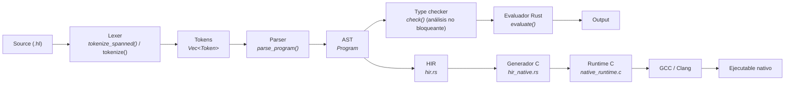
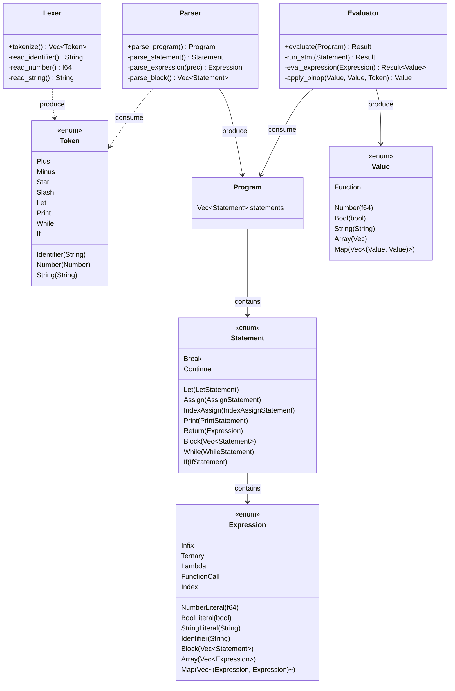

# HackLang

Lenguaje de programación con frontend e intérprete en Rust y backend de compilación nativa a C. El backend nativo ya ejecuta arrays, mapas, indexación, `len`, funciones, closures, capturas mutables, llamadas de orden superior y recursión. La paridad completa con el intérprete sigue siendo un objetivo incremental.

## Arquitectura



### Componentes



## Sintaxis

```hacklang
let x = 42;
print x;

let y = x + 1;

while (i < 10) (
  print i;
  i = i + 1;
)

let result = (x > 10) ? ( x ) : ( 0 );

let add = |a, b| ( a + b );
print add(3, 4);

let datos = @( "host": "127.0.0.1", "port": 80 );
print datos["host"];
```

Los ejemplos ejecutables de la versión actual están en `examples/`. Los bocetos que dependen de funciones todavía inexistentes (`read_file`, `write_file`, `exec`) se conservan en `prototypes/unsupported/` y no son programas ejecutables.

## Cómo usar

Desde la raíz del repositorio:

```bash
# Interpretar (se conserva la invocación legacy)
cargo run -- run examples/test.hl
cargo run -- examples/test.hl

# Compilar un programa del subconjunto nativo actual
cat > hello.hl <<'EOF'
let answer = 40 + 2;
print answer;
EOF
cargo run -- build hello.hl
./hello

# Elegir el nombre del ejecutable
cargo run -- build hello.hl -o hello-custom
./hello-custom

# Comprobar sintaxis y mostrar avisos del análisis estático, sin ejecutar
cargo run -- check examples/test.hl

# Sintaxis compacta, formateo y diagnósticos JSON
cargo run -- run --compact programa-compacto.hl
cargo run -- run --format programa.hl
cargo run -- check --diagnostics-json programa.hl

# Límites defensivos configurables (256 por defecto)
cargo run -- run --max-parse-depth 512 --max-eval-depth 128 programa.hl
cargo run -- check --max-parse-depth 512 programa.hl
cargo run -- build --max-parse-depth 512 programa.hl
```

Los ejecutables nativos limitan también el trabajo de ejecución: 1.000.000 de pasos por defecto. El contador es compartido por el programa, sus funciones y los bucles. Se puede ajustar al lanzar el ejecutable mediante la variable de entorno:

```bash
HACKLANG_MAX_EVAL_STEPS=500000 ./hello
HACKLANG_MAX_EVAL_MILLIS=10000 ./hello

El intérprete aplica un presupuesto temporal cooperativo predeterminado de 30 segundos por ejecución. Se puede ajustar mediante `HACKLANG_MAX_EVAL_MILLIS` o `hl run --max-eval-millis N` (milisegundos). El límite se comprueba entre sentencias y no interrumpe una operación individual que bloquee o tarde mucho sin volver al evaluador.
```

El runtime nativo también limita el tiempo de CPU de cada ejecución a 30 segundos por defecto. Se puede ajustar con `HACKLANG_MAX_EVAL_MILLIS`:

```bash
HACKLANG_MAX_EVAL_MILLIS=10000 ./hello
```

El reloj se consulta en cada punto de control del runtime (sentencias e iteraciones de `while`). Es un límite cooperativo de tiempo de CPU: no puede interrumpir una llamada externa o una operación nativa bloqueante que no vuelva al runtime.

Un valor no numérico, vacío o cero no sustituye el límite predeterminado.

El runtime nativo también limita las reservas acumuladas de bloques de arena a 256 MiB por ejecución. Se puede ajustar con:

```bash
HACKLANG_MAX_ARENA_BYTES=67108864 ./hello
```

Este límite contabiliza la capacidad reservada por las arenas administradas mediante `hl_alloc`. El runtime también contabiliza las asignaciones auxiliares de heap (closures, celdas capturadas, registros de ownership, raíces temporales y buffers de cadenas), incluyendo la sobrecarga de sus cabeceras. El presupuesto auxiliar predeterminado es de 256 MiB por ejecución y se puede ajustar con:

```bash
HACKLANG_MAX_HEAP_BYTES=67108864 ./hello
```

Los dos presupuestos son independientes: hasta 256 MiB de capacidad de arenas y 256 MiB de heap auxiliar por defecto. No constituyen un límite absoluto de RSS del proceso: quedan fuera pequeñas estructuras de control como el descriptor del entorno y del lane, las propias cabeceras del allocator del sistema y recursos internos de libc.


### Diagnósticos estructurados

`--diagnostics-json` emite un array JSON. Cada elemento contiene `code` (identificador estable), `phase` (`lexing`, `parsing`, `type_check`, `lowering`, `native_codegen` o `runtime`), `severity` (`error` o `warning`), `message` y `range` (objeto con offsets/línea/columna o `null`). Los errores del lexer, parser, lowering HIR, compilación nativa y evaluador Rust usan este formato cuando se solicita JSON. El evaluador Rust adjunta el rango de la sentencia que falla cuando se dispone del sidecar de spans; si no hay provenance, `range` es `null`. Los traps de ejecutables nativos también pueden emitirlo con `HACKLANG_DIAGNOSTICS=json ./programa`; su rango sigue siendo `null` hasta conservar provenance por nodo HIR. La salida textual tradicional se conserva por defecto.

Ejemplo de forma:

```json
[
  {
    "code": "HL-LEX-001",
    "phase": "lexing",
    "severity": "error",
    "message": "Carácter inesperado: ' El subconjunto nativo incluye números, booleanos, cadenas, variables, operadores, ternarios, `if`, `while`, `break`/`continue`, `print`, arrays, mapas, lectura y asignación indexada (también anidada) y `len(x)` para strings, arrays y mapas. Las llamadas directas y dinámicas a funciones/closures están soportadas, incluidas capturas, llamadas de orden superior y recursión. `len` es el builtin de colecciones implementado actualmente.

Para generar el ejecutable optimizado `hl`:

```bash
cargo build --release
./target/release/hl examples/test.hl
```

En Windows, el ejecutable se genera como `target/release/hl.exe`. Cargo gestiona los artefactos de compilación dentro de `target/`, que no se versiona.

### Sintaxis compacta experimental

La sintaxis compacta se activa explícitamente con `--compact`; el modo legacy sigue siendo el predeterminado y conserva su gramática.

```hacklang
n:=10
sum:=0
while n>0{
  sum=sum+n
  n=n-1
}
print sum

fact:=|n|{
  if n<2{return 1}else{return n*fact(n-1)}
}
print fact(5)
```

Ejecutar un archivo compacto:

```bash
cargo run -- --compact compact.hl
```

Convertir un programa legacy a la forma canónica compacta (sin ejecutarlo):

```bash
cargo run -- --format programa.hl
```

Para formatear un archivo que ya usa el modo compacto:

```bash
cargo run -- --compact --format compact.hl

# Static diagnostics as JSON (analysis only; does not execute the program)
cargo run -- --diagnostics-json programa.hl
```

En esta primera versión se compactan las declaraciones (`:=`), los bloques (`{}`), las condiciones de `if/while`, los cuerpos de lambdas y los mapas (`@{}`). En modo legacy, las declaraciones usan `let`, los bloques usan `(...)` y los mapas usan `@(...)`. Se mantienen `print`, `return`, `break` y `continue` como palabras clave para evitar colisiones con operadores existentes. No se exige punto y coma entre sentencias cuando el siguiente token permite determinar el final de la expresión.

## Compilación nativa: primer subconjunto operativo

La CLI dispone de `hl run`, `hl build` y `hl check`; `hl archivo.hl` sigue siendo el alias de interpretación. `build` reutiliza el mismo lexer, parser y AST, lo reduce a HIR con bindings y ámbitos resueltos, y genera C desde HIR mediante GCC o Clang.

El backend admite literales, variables, operadores, control de flujo, arrays, mapas, indexación (incluida la de cadenas), `len(x)` y funciones/closures con cuerpos de expresión o bloque, parámetros, `return`, capturas compartidas mutables, llamadas de orden superior y recursión. HIR resuelve identificadores a `BindingId`, contiene el análisis de capturas y el plan lógico de almacenamiento; es la entrada del generador C.

El runtime C usa valores etiquetados, arenas bump por ámbito/lane y slots físicos `HlFrame` para escalares. `MemoryPlan.scope_stacks` se materializa como lanes reutilizables; arrays y mapas se clonan recursivamente para preservar semántica de valor. Las llamadas crean entornos y frames de activación; los bindings capturados viven en celdas estables compartidas, incluso cuando escapan de la activación creadora. Un registro de frames activos y raíces temporales permite trazar celdas y closures, incluidas las anidadas en arrays/mapas, y recoger ciclos de closures inalcanzables. Es un recolector especializado para el grafo de celdas/closures, no un GC general de todos los objetos. La integración del plan de memoria es parcial: aún falta completar el análisis transitivo de escapes y demostrar todos los contratos de propiedad/liberación. Los errores fatales limpian los entornos activos y terminan con código 1. No se crea un parser ni un AST alternativo, y el checker estático no es requisito para compilar. Diseño y límites: [docs/NATIVE_COMPILER_DESIGN.md](docs/NATIVE_COMPILER_DESIGN.md).

## Metodología

### Pipeline de ejecución

HackLang mantiene un único front-end compartido. El intérprete recorre el AST en Rust; el backend nativo transforma AST→HIR y genera C desde HIR. La HIR es la frontera semántica del backend, no un segundo frontend:

```
Source (.hl) ─▶ Lexer ─▶ Parser ─▶ AST ─┬─▶ Evaluator Rust ─▶ Output
                                        └─▶ HIR ─▶ C Generator ─▶ Runtime C ─▶ GCC/Clang ─▶ Executable
```

Cada fase es un módulo independiente de Rust (`lexer.rs`, `parser.rs`, `evaluador.rs`, `hir.rs`, `hir_native.rs`) que se comunica con la siguiente mediante tipos explícitos. El análisis estático sigue siendo una pasada independiente y no bloqueante entre el parser y el evaluador. HIR resuelve ámbitos e identidad de bindings; todavía no hay optimizaciones de alto nivel ni paridad nativa completa.

### Flujo de errores

Los errores se propagan con `Result<T, String>` en lugar de `panic!` o excepciones. Cada fase puede fallar y el error sube hasta `main()`:

```
Evaluator → Err(String) → main → eprintln!("Error en tiempo de ejecución: {e}")
```

Esto mantiene el programa principal limpio (línea 48 de `main.rs`) y toda la lógica de error dentro de cada fase.

## Arquitectura y Patrones de Diseño

### Interpreter Pattern (el patrón central)

HackLang implementa el **Interpreter pattern** del GoF, adaptado a Rust con enums y pattern matching:

```rust
// AST = expresión jerárquica
enum Expression {
    NumberLiteral(f64),
    Infix { left: Box<Expression>, operator: Token, right: Box<Expression> },
    Ternary { condition: Box<Expression>, true_branch: Box<Expression>, false_branch: Box<Expression> },
    // ...
}

// Evaluator = walker recursivo
fn eval_expression(&self, expr: &Expression) -> Result<Value, String> {
    match expr {
        Expression::NumberLiteral(n) => Ok(Value::Number(*n)),
        Expression::Infix { left, operator, right } => {
            let l = self.eval_expression(left)?;
            let r = self.eval_expression(right)?;
            self.apply_binop(l, r, operator)
        }
        // ...
    }
}
```

No se usan trait objects ni vtables. El AST es un enum con variantes planas y el evaluador es una función que recorre el árbol con `match`. Esto es deliberado: KISS sobre abstracción.

### Pratt Parser (expresiones)

El parser de expresiones usa **Pratt parsing** (también llamado _Top-Down Operator Precedence_), que asigna precedencia a cada token y resuelve la asociatividad de forma matemática sin necesidad de una gramática LR o un parser generator:

```rust
fn parse_expression(&mut self, precedence: Precedence) -> Result<Expression, String> {
    let mut left = self.parse_prefix()?;
    while precedence < self.get_precedence(self.current_token()) {
        let op = self.current_token().clone();
        self.advance();
        let right = self.parse_expression(self.get_precedence(&op))?;
        left = Expression::Infix { left: Box::new(left), operator: op, right: Box::new(right) };
    }
    // Post-procesamiento para ternario
    Ok(left)
}
```

Ventaja sobre alternatives como `nom` o `peg`:
- Control total sobre errores y recuperación (mensajes en español)
- Sin dependencias externas
- Código explícito y legible

### Recursive Descent (sentencias)

El parser de sentencias usa **Recursive Descent**: una función por cada construcción del lenguaje (`parse_let_statement`, `parse_while_statement`, `parse_if_statement`, etc.), cada una avanzando tokens y llamando a otras funciones de parsing según la gramática.

### Visitor sobre enums (evaluador)

El evaluador actúa como un **Visitor** pero sin el patrón clásico de doble dispatch — Rust lo resuelve con `match` sobre el enum del AST:

```rust
fn run_stmt(&mut self, stmt: &Statement) -> Result<Flow, String> {
    match stmt {
        Statement::Let(l)       => self.eval_let(l).map(|_| Flow::Continue),
        Statement::Return(expr) => self.eval_expression(expr).map(Flow::Return),
        Statement::Break         => Ok(Flow::Break),
        Statement::Continue      => Ok(Flow::LoopContinue),
        Statement::Block(ss)     => { /* propaga Return, Break y Continue */ }
        Statement::While(w)      => { /* consume Break/Continue y propaga Return */ }
        Statement::If(i)         => { /* evalúa condición y propaga el flujo */ }
        // Assign, IndexAssign y Print también producen Flow::Continue.
    }
}
```

### Entornos léxicos y closures

El runtime mantiene un arena de entornos (`Vec<Environment>`). Cada entorno contiene un `HashMap<String, Value>` y un enlace opcional a su entorno padre. Las variables se resuelven recorriendo esa cadena, desde el ámbito actual hacia los padres.

- `let` crea o reemplaza una vinculación en el ámbito actual.
- La asignación `x = ...` actualiza la vinculación existente más cercana.
- Los bloques, ramas, bucles y llamadas crean nuevos entornos.
- Una lambda captura el identificador estable del entorno donde se define. No clona todas las variables: ve también las modificaciones posteriores y puede ser recursiva.
- Los bloques, ramas, bucles y llamadas crean entornos con padre léxico.
- El recolector mark-and-sweep recupera frames no alcanzables y reutiliza sus IDs. Los valores contenidos siguen bajo gestión de memoria de Rust.

## Principios Aplicados

### KISS (Keep It Simple, Stupid) — principio rector

Cada decisión de diseño se tomó preguntando "¿esto añade complejidad sin necesidad inmediata?":

- **Sin IR**: evaluamos directamente del AST, sin capa intermedia de optimización.
- **Sin trait objects**: el AST usa enums, no `Box<dyn Node>`. Pattern matching es más simple que vtables.
- **Sin genéricos ni macros complejas**: el evaluador es código plano con `match`.
- **Sin lifetimes complejas**: se clona lo necesario (`s.clone()`, `name.clone()`) en lugar de tejer referencias.

### YAGNI (You Aren't Gonna Need It)

El intérprete Rust y el backend C ejecutan funciones y closures. El backend genera cuerpos y frames de activación, conserva celdas capturadas compartidas y despacha llamadas directas o dinámicas. Las características todavía no soportadas deben fallar explícitamente, nunca simularse con valores por defecto.

### DRY — con límites

Donde tiene sentido, hay factorización clara (ej: `parse_block` y `parse_block_statement` comparten lógica). Pero no se fuerza la abstracción donde haría el código más opaco.

### Error Handling idiomático en Rust

Toda función que puede fallar devuelve `Result<T, String>`. El operador `?` propaga errores automáticamente:

```rust
fn evaluate(&mut self, program: &Program) -> Result<(), String> {
    for stmt in &program.statements {
        self.run_stmt(stmt)?;  // si falla, corta y sube el error
    }
    Ok(())
}
```

El lexer y el parser devuelven `Result`: los caracteres desconocidos, las cadenas sin cerrar y los errores sintácticos llegan al CLI como mensajes controlados, sin provocar un `panic!`.

## Estado

El CLI se construye como el ejecutable `hl`. En desarrollo se invoca con `cargo run -- ...`; en release, Cargo genera `target/release/hl` (o `hl.exe` en Windows). `hl build` genera ejecutables nativos mediante el backend C para el subconjunto descrito en «Compilación nativa»; no equivale aún a cobertura completa del lenguaje.

| Componente | Estado |
|---|---|
| **Lexer** | ✅ Tokenización, palabras clave, operadores, cadenas y errores recuperables |
| **Parser** | ✅ Expresiones, ternario, lambdas, llamadas postfix, bloques, arrays, mapas e indexación |
| **Evaluador** | ✅ Evaluación de expresiones, booleanos, sentencias, ámbitos léxicos y colecciones |
| **Funciones** | ✅ Lambdas, closures léxicas, recursividad, llamadas de primera clase y aridad |
| **Control de flujo** | ✅ `return`, `break` y `continue` |
| **Memoria actual** | Rust: mark-and-sweep de entornos. C: arenas bump, slots de activación, celdas capturadas estables y tracing especializado de ciclos de closures/celdas. Integración parcial; escape analysis transitiva y propiedad general aún incompletas |
| **Análisis de tipos** | ✅ Primera pasada no bloqueante: tipos primitivos, retornos explícitos, arrays/mapas con tipos de elemento/clave/valor, indexación, asignaciones, operadores y aridad de llamadas |
| **Compilador nativo** | Backend HIR→C con arrays, mapas, indexación, strings, `len`, funciones, closures, capturas, llamadas de orden superior y recursión. Paridad diferencial en expansión |
| **Tests** | Tests Rust, ejecución de todos los ejemplos y smoke diferencial intérprete/nativo, incluida división por cero; falta ampliar la matriz de conformidad |


## Funcionalidad del runtime

- Las lambdas se evalúan como funciones y capturan el ID estable del entorno léxico donde se definen.
- Las llamadas comprueban el número de argumentos y ejecutan el cuerpo en un entorno local cuyo padre es el entorno capturado.
- Los cuerpos de función admiten varias sentencias y `return` explícito.
- `return` se propaga a través de bloques, ramas y bucles; `break` y `continue` controlan el bucle más cercano.
- Los arrays admiten literales, lectura por índice y actualización de posiciones existentes.
- Los mapas admiten claves y valores evaluados, lectura por clave y alta o actualización de entradas.
- La indexación de cadenas devuelve el carácter solicitado.
- Los errores al evaluar condiciones de `while` se propagan; ya no se convierten silenciosamente en una condición falsa.

Limitaciones actuales: los mapas se representan como pares ordenados y su búsqueda es lineal. El comprobador estático inicial es deliberadamente no bloqueante: informa de incompatibilidades demostrables y deja como `unknown` los casos que aún no puede inferir. La indexación de strings está implementada en ambos runtimes y debe mantenerse bajo paridad diferencial. Las comparaciones numéricas producen `true` o `false`, no `1` o `0`.


## Modelo de memoria y ejecución

- **Stack (pila):** la evaluación de expresiones y las llamadas a funciones usan recursión de Rust; por tanto, la pila de llamadas real es la pila nativa del proceso. El evaluador y el parser aplican límites defensivos de 256 niveles por defecto y devuelven errores controlados al superarlos. Se pueden ajustar con `--max-eval-depth N` (solo `run`) y `--max-parse-depth N` (`run`, `check` y `build`); ambos requieren enteros positivos. Estos límites no equivalen a límites de instrucciones, memoria o tiempo, que siguen pendientes. Los bucles del lenguaje se ejecutan iterativamente. HackLang todavía no tiene una VM ni una pila de operandos propia.
- **Heap (montículo):** el AST usa `Box` para nodos recursivos y `Vec` para listas; cadenas, mapas y tablas de variables usan estructuras propiedad de Rust. El arena de entornos también vive en el heap. Un recolector mark-and-sweep recupera frames no alcanzables y reutiliza sus posiciones; no es un GC general de objetos, porque los valores los gestiona Rust.
- **Closures:** guardan un ID de entorno, no una copia completa del `HashMap`. La cadena de entornos proporciona el alcance léxico y permite recursividad.
- **Liberación:** Rust libera automáticamente los valores cuando se destruye el evaluador. El arena recolecta frames inalcanzables después de cada sentencia, incluyendo el seguimiento de closures contenidas en valores y de closures devueltas temporalmente. No hay un garbage collector general para todos los objetos: Rust gestiona la vida de cadenas, arrays, mapas y AST.


### Errores léxicos y sintácticos

El lexer expone `tokenize() -> Result<Vec<Token>, String>` y el parser `parse_program() -> Result<Program, String>`. Un carácter desconocido, una cadena sin cerrar o una sentencia mal formada produce un error recuperable que el ejecutable muestra al usuario. Las pruebas cubren también cadenas Unicode para evitar errores al confundir índices de caracteres con índices de bytes.


## Modelo de memoria objetivo

El objetivo sigue siendo un modelo **stack-first, sin GC general y sin gestión manual del usuario**. El evaluador Rust conserva su recolector de entornos. En C, `MemoryPlan` dirige lanes regionales y slots inline; las activaciones usan frames, y las capturas viven en celdas estables. Un tracing collector limitado al grafo de celdas/closures rompe ciclos inalcanzables; no gestiona de forma general todos los objetos. Arrays, mapas, strings indexables, llamadas y closures ya tienen soporte nativo con pruebas diferenciales. La integración del modelo de memoria sigue siendo parcial: falta completar escape analysis transitiva, la propiedad de todos los valores dinámicos y la validación exhaustiva con sanitizers. La matriz de diseño y su cobertura están en [docs/MEMORY_MODEL.md](docs/MEMORY_MODEL.md).

## Biblioteca estándar inicial

- `len(x)`: número de caracteres Unicode en strings o cantidad de elementos en arrays y mapas. Acepta un argumento y valida tipos en análisis estático.

## Arquitectura del compilador

El frontend (lexer, parser y AST) es único para intérprete y compilador nativo. La HIR inicial ya está implementada en `src/hir.rs`, con IDs de expresión/sentencia, ámbitos y bindings resueltos; el backend C la consume desde `src/hir_native.rs`. La cobertura HIR/nativa sigue siendo parcial. Consulta [docs/HIR_DESIGN.md](docs/HIR_DESIGN.md) y [docs/AI_AUTHORING.md](docs/AI_AUTHORING.md).
",
    "range": {
      "start": 10,
      "end": 11,
      "line": 1,
      "column": 11,
      "endLine": 1,
      "endColumn": 12
    }
  }
]
```

`hl build programa.hl [-o ejecutable]` genera un ejecutable nativo mediante GCC o Clang. El subconjunto nativo incluye números, booleanos, cadenas, variables, operadores, ternarios, `if`, `while`, `break`/`continue`, `print`, arrays, mapas, lectura y asignación indexada (también anidada) y `len(x)` para strings, arrays y mapas. Las llamadas directas y dinámicas a funciones/closures están soportadas, incluidas capturas, llamadas de orden superior y recursión. `len` es el builtin de colecciones implementado actualmente.

Para generar el ejecutable optimizado `hl`:

```bash
cargo build --release
./target/release/hl examples/test.hl
```

En Windows, el ejecutable se genera como `target/release/hl.exe`. Cargo gestiona los artefactos de compilación dentro de `target/`, que no se versiona.

### Sintaxis compacta experimental

La sintaxis compacta se activa explícitamente con `--compact`; el modo legacy sigue siendo el predeterminado y conserva su gramática.

```hacklang
n:=10
sum:=0
while n>0{
  sum=sum+n
  n=n-1
}
print sum

fact:=|n|{
  if n<2{return 1}else{return n*fact(n-1)}
}
print fact(5)
```

Ejecutar un archivo compacto:

```bash
cargo run -- --compact compact.hl
```

Convertir un programa legacy a la forma canónica compacta (sin ejecutarlo):

```bash
cargo run -- --format programa.hl
```

Para formatear un archivo que ya usa el modo compacto:

```bash
cargo run -- --compact --format compact.hl

# Static diagnostics as JSON (analysis only; does not execute the program)
cargo run -- --diagnostics-json programa.hl
```

En esta primera versión se compactan las declaraciones (`:=`), los bloques (`{}`), las condiciones de `if/while`, los cuerpos de lambdas y los mapas (`@{}`). En modo legacy, las declaraciones usan `let`, los bloques usan `(...)` y los mapas usan `@(...)`. Se mantienen `print`, `return`, `break` y `continue` como palabras clave para evitar colisiones con operadores existentes. No se exige punto y coma entre sentencias cuando el siguiente token permite determinar el final de la expresión.

## Compilación nativa: primer subconjunto operativo

La CLI dispone de `hl run`, `hl build` y `hl check`; `hl archivo.hl` sigue siendo el alias de interpretación. `build` reutiliza el mismo lexer, parser y AST, lo reduce a HIR con bindings y ámbitos resueltos, y genera C desde HIR mediante GCC o Clang.

El backend admite literales, variables, operadores, control de flujo, arrays, mapas, indexación (incluida la de cadenas), `len(x)` y funciones/closures con cuerpos de expresión o bloque, parámetros, `return`, capturas compartidas mutables, llamadas de orden superior y recursión. HIR resuelve identificadores a `BindingId`, contiene el análisis de capturas y el plan lógico de almacenamiento; es la entrada del generador C.

El runtime C usa valores etiquetados, arenas bump por ámbito/lane y slots físicos `HlFrame` para escalares. `MemoryPlan.scope_stacks` se materializa como lanes reutilizables; arrays y mapas se clonan recursivamente para preservar semántica de valor. Las llamadas crean entornos y frames de activación; los bindings capturados viven en celdas estables compartidas, incluso cuando escapan de la activación creadora. Un registro de frames activos y raíces temporales permite trazar celdas y closures, incluidas las anidadas en arrays/mapas, y recoger ciclos de closures inalcanzables. Es un recolector especializado para el grafo de celdas/closures, no un GC general de todos los objetos. La integración del plan de memoria es parcial: aún falta completar el análisis transitivo de escapes y demostrar todos los contratos de propiedad/liberación. Los errores fatales limpian los entornos activos y terminan con código 1. No se crea un parser ni un AST alternativo, y el checker estático no es requisito para compilar. Diseño y límites: [docs/NATIVE_COMPILER_DESIGN.md](docs/NATIVE_COMPILER_DESIGN.md).

## Metodología

### Pipeline de ejecución

HackLang mantiene un único front-end compartido. El intérprete recorre el AST en Rust; el backend nativo transforma AST→HIR y genera C desde HIR. La HIR es la frontera semántica del backend, no un segundo frontend:

```
Source (.hl) ─▶ Lexer ─▶ Parser ─▶ AST ─┬─▶ Evaluator Rust ─▶ Output
                                        └─▶ HIR ─▶ C Generator ─▶ Runtime C ─▶ GCC/Clang ─▶ Executable
```

Cada fase es un módulo independiente de Rust (`lexer.rs`, `parser.rs`, `evaluador.rs`, `hir.rs`, `hir_native.rs`) que se comunica con la siguiente mediante tipos explícitos. El análisis estático sigue siendo una pasada independiente y no bloqueante entre el parser y el evaluador. HIR resuelve ámbitos e identidad de bindings; todavía no hay optimizaciones de alto nivel ni paridad nativa completa.

### Flujo de errores

Los errores se propagan con `Result<T, String>` en lugar de `panic!` o excepciones. Cada fase puede fallar y el error sube hasta `main()`:

```
Evaluator → Err(String) → main → eprintln!("Error en tiempo de ejecución: {e}")
```

Esto mantiene el programa principal limpio (línea 48 de `main.rs`) y toda la lógica de error dentro de cada fase.

## Arquitectura y Patrones de Diseño

### Interpreter Pattern (el patrón central)

HackLang implementa el **Interpreter pattern** del GoF, adaptado a Rust con enums y pattern matching:

```rust
// AST = expresión jerárquica
enum Expression {
    NumberLiteral(f64),
    Infix { left: Box<Expression>, operator: Token, right: Box<Expression> },
    Ternary { condition: Box<Expression>, true_branch: Box<Expression>, false_branch: Box<Expression> },
    // ...
}

// Evaluator = walker recursivo
fn eval_expression(&self, expr: &Expression) -> Result<Value, String> {
    match expr {
        Expression::NumberLiteral(n) => Ok(Value::Number(*n)),
        Expression::Infix { left, operator, right } => {
            let l = self.eval_expression(left)?;
            let r = self.eval_expression(right)?;
            self.apply_binop(l, r, operator)
        }
        // ...
    }
}
```

No se usan trait objects ni vtables. El AST es un enum con variantes planas y el evaluador es una función que recorre el árbol con `match`. Esto es deliberado: KISS sobre abstracción.

### Pratt Parser (expresiones)

El parser de expresiones usa **Pratt parsing** (también llamado _Top-Down Operator Precedence_), que asigna precedencia a cada token y resuelve la asociatividad de forma matemática sin necesidad de una gramática LR o un parser generator:

```rust
fn parse_expression(&mut self, precedence: Precedence) -> Result<Expression, String> {
    let mut left = self.parse_prefix()?;
    while precedence < self.get_precedence(self.current_token()) {
        let op = self.current_token().clone();
        self.advance();
        let right = self.parse_expression(self.get_precedence(&op))?;
        left = Expression::Infix { left: Box::new(left), operator: op, right: Box::new(right) };
    }
    // Post-procesamiento para ternario
    Ok(left)
}
```

Ventaja sobre alternatives como `nom` o `peg`:
- Control total sobre errores y recuperación (mensajes en español)
- Sin dependencias externas
- Código explícito y legible

### Recursive Descent (sentencias)

El parser de sentencias usa **Recursive Descent**: una función por cada construcción del lenguaje (`parse_let_statement`, `parse_while_statement`, `parse_if_statement`, etc.), cada una avanzando tokens y llamando a otras funciones de parsing según la gramática.

### Visitor sobre enums (evaluador)

El evaluador actúa como un **Visitor** pero sin el patrón clásico de doble dispatch — Rust lo resuelve con `match` sobre el enum del AST:

```rust
fn run_stmt(&mut self, stmt: &Statement) -> Result<Flow, String> {
    match stmt {
        Statement::Let(l)       => self.eval_let(l).map(|_| Flow::Continue),
        Statement::Return(expr) => self.eval_expression(expr).map(Flow::Return),
        Statement::Break         => Ok(Flow::Break),
        Statement::Continue      => Ok(Flow::LoopContinue),
        Statement::Block(ss)     => { /* propaga Return, Break y Continue */ }
        Statement::While(w)      => { /* consume Break/Continue y propaga Return */ }
        Statement::If(i)         => { /* evalúa condición y propaga el flujo */ }
        // Assign, IndexAssign y Print también producen Flow::Continue.
    }
}
```

### Entornos léxicos y closures

El runtime mantiene un arena de entornos (`Vec<Environment>`). Cada entorno contiene un `HashMap<String, Value>` y un enlace opcional a su entorno padre. Las variables se resuelven recorriendo esa cadena, desde el ámbito actual hacia los padres.

- `let` crea o reemplaza una vinculación en el ámbito actual.
- La asignación `x = ...` actualiza la vinculación existente más cercana.
- Los bloques, ramas, bucles y llamadas crean nuevos entornos.
- Una lambda captura el identificador estable del entorno donde se define. No clona todas las variables: ve también las modificaciones posteriores y puede ser recursiva.
- Los bloques, ramas, bucles y llamadas crean entornos con padre léxico.
- El recolector mark-and-sweep recupera frames no alcanzables y reutiliza sus IDs. Los valores contenidos siguen bajo gestión de memoria de Rust.

## Principios Aplicados

### KISS (Keep It Simple, Stupid) — principio rector

Cada decisión de diseño se tomó preguntando "¿esto añade complejidad sin necesidad inmediata?":

- **Sin IR**: evaluamos directamente del AST, sin capa intermedia de optimización.
- **Sin trait objects**: el AST usa enums, no `Box<dyn Node>`. Pattern matching es más simple que vtables.
- **Sin genéricos ni macros complejas**: el evaluador es código plano con `match`.
- **Sin lifetimes complejas**: se clona lo necesario (`s.clone()`, `name.clone()`) en lugar de tejer referencias.

### YAGNI (You Aren't Gonna Need It)

El intérprete Rust y el backend C ejecutan funciones y closures. El backend genera cuerpos y frames de activación, conserva celdas capturadas compartidas y despacha llamadas directas o dinámicas. Las características todavía no soportadas deben fallar explícitamente, nunca simularse con valores por defecto.

### DRY — con límites

Donde tiene sentido, hay factorización clara (ej: `parse_block` y `parse_block_statement` comparten lógica). Pero no se fuerza la abstracción donde haría el código más opaco.

### Error Handling idiomático en Rust

Toda función que puede fallar devuelve `Result<T, String>`. El operador `?` propaga errores automáticamente:

```rust
fn evaluate(&mut self, program: &Program) -> Result<(), String> {
    for stmt in &program.statements {
        self.run_stmt(stmt)?;  // si falla, corta y sube el error
    }
    Ok(())
}
```

El lexer y el parser devuelven `Result`: los caracteres desconocidos, las cadenas sin cerrar y los errores sintácticos llegan al CLI como mensajes controlados, sin provocar un `panic!`.

## Estado

El CLI se construye como el ejecutable `hl`. En desarrollo se invoca con `cargo run -- ...`; en release, Cargo genera `target/release/hl` (o `hl.exe` en Windows). `hl build` genera ejecutables nativos mediante el backend C para el subconjunto descrito en «Compilación nativa»; no equivale aún a cobertura completa del lenguaje.

| Componente | Estado |
|---|---|
| **Lexer** | ✅ Tokenización, palabras clave, operadores, cadenas y errores recuperables |
| **Parser** | ✅ Expresiones, ternario, lambdas, llamadas postfix, bloques, arrays, mapas e indexación |
| **Evaluador** | ✅ Evaluación de expresiones, booleanos, sentencias, ámbitos léxicos y colecciones |
| **Funciones** | ✅ Lambdas, closures léxicas, recursividad, llamadas de primera clase y aridad |
| **Control de flujo** | ✅ `return`, `break` y `continue` |
| **Memoria actual** | Rust: mark-and-sweep de entornos. C: arenas bump, slots de activación, celdas capturadas estables y tracing especializado de ciclos de closures/celdas. Integración parcial; escape analysis transitiva y propiedad general aún incompletas |
| **Análisis de tipos** | ✅ Primera pasada no bloqueante: tipos primitivos, retornos explícitos, arrays/mapas con tipos de elemento/clave/valor, indexación, asignaciones, operadores y aridad de llamadas |
| **Compilador nativo** | Backend HIR→C con arrays, mapas, indexación, strings, `len`, funciones, closures, capturas, llamadas de orden superior y recursión. Paridad diferencial en expansión |
| **Tests** | Tests Rust, ejecución de todos los ejemplos y smoke diferencial intérprete/nativo, incluida división por cero; falta ampliar la matriz de conformidad |


## Funcionalidad del runtime

- Las lambdas se evalúan como funciones y capturan el ID estable del entorno léxico donde se definen.
- Las llamadas comprueban el número de argumentos y ejecutan el cuerpo en un entorno local cuyo padre es el entorno capturado.
- Los cuerpos de función admiten varias sentencias y `return` explícito.
- `return` se propaga a través de bloques, ramas y bucles; `break` y `continue` controlan el bucle más cercano.
- Los arrays admiten literales, lectura por índice y actualización de posiciones existentes.
- Los mapas admiten claves y valores evaluados, lectura por clave y alta o actualización de entradas.
- La indexación de cadenas devuelve el carácter solicitado.
- Los errores al evaluar condiciones de `while` se propagan; ya no se convierten silenciosamente en una condición falsa.

Limitaciones actuales: los mapas se representan como pares ordenados y su búsqueda es lineal. El comprobador estático inicial es deliberadamente no bloqueante: informa de incompatibilidades demostrables y deja como `unknown` los casos que aún no puede inferir. La indexación de strings está implementada en ambos runtimes y debe mantenerse bajo paridad diferencial. Las comparaciones numéricas producen `true` o `false`, no `1` o `0`.


## Modelo de memoria y ejecución

- **Stack (pila):** la evaluación de expresiones y las llamadas a funciones usan recursión de Rust; por tanto, la pila de llamadas real es la pila nativa del proceso. El evaluador y el parser aplican límites defensivos de 256 niveles por defecto y devuelven errores controlados al superarlos. Se pueden ajustar con `--max-eval-depth N` (solo `run`) y `--max-parse-depth N` (`run`, `check` y `build`); ambos requieren enteros positivos. Estos límites no equivalen a límites de instrucciones, memoria o tiempo, que siguen pendientes. Los bucles del lenguaje se ejecutan iterativamente. HackLang todavía no tiene una VM ni una pila de operandos propia.
- **Heap (montículo):** el AST usa `Box` para nodos recursivos y `Vec` para listas; cadenas, mapas y tablas de variables usan estructuras propiedad de Rust. El arena de entornos también vive en el heap. Un recolector mark-and-sweep recupera frames no alcanzables y reutiliza sus posiciones; no es un GC general de objetos, porque los valores los gestiona Rust.
- **Closures:** guardan un ID de entorno, no una copia completa del `HashMap`. La cadena de entornos proporciona el alcance léxico y permite recursividad.
- **Liberación:** Rust libera automáticamente los valores cuando se destruye el evaluador. El arena recolecta frames inalcanzables después de cada sentencia, incluyendo el seguimiento de closures contenidas en valores y de closures devueltas temporalmente. No hay un garbage collector general para todos los objetos: Rust gestiona la vida de cadenas, arrays, mapas y AST.


### Errores léxicos y sintácticos

El lexer expone `tokenize() -> Result<Vec<Token>, String>` y el parser `parse_program() -> Result<Program, String>`. Un carácter desconocido, una cadena sin cerrar o una sentencia mal formada produce un error recuperable que el ejecutable muestra al usuario. Las pruebas cubren también cadenas Unicode para evitar errores al confundir índices de caracteres con índices de bytes.


## Modelo de memoria objetivo

El objetivo sigue siendo un modelo **stack-first, sin GC general y sin gestión manual del usuario**. El evaluador Rust conserva su recolector de entornos. En C, `MemoryPlan` dirige lanes regionales y slots inline; las activaciones usan frames, y las capturas viven en celdas estables. Un tracing collector limitado al grafo de celdas/closures rompe ciclos inalcanzables; no gestiona de forma general todos los objetos. Arrays, mapas, strings indexables, llamadas y closures ya tienen soporte nativo con pruebas diferenciales. La integración del modelo de memoria sigue siendo parcial: falta completar escape analysis transitiva, la propiedad de todos los valores dinámicos y la validación exhaustiva con sanitizers. La matriz de diseño y su cobertura están en [docs/MEMORY_MODEL.md](docs/MEMORY_MODEL.md).

## Biblioteca estándar inicial

- `len(x)`: número de caracteres Unicode en strings o cantidad de elementos en arrays y mapas. Acepta un argumento y valida tipos en análisis estático.

## Arquitectura del compilador

El frontend (lexer, parser y AST) es único para intérprete y compilador nativo. La HIR inicial ya está implementada en `src/hir.rs`, con IDs de expresión/sentencia, ámbitos y bindings resueltos; el backend C la consume desde `src/hir_native.rs`. La cobertura HIR/nativa sigue siendo parcial. Consulta [docs/HIR_DESIGN.md](docs/HIR_DESIGN.md) y [docs/AI_AUTHORING.md](docs/AI_AUTHORING.md).
