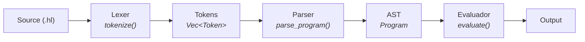
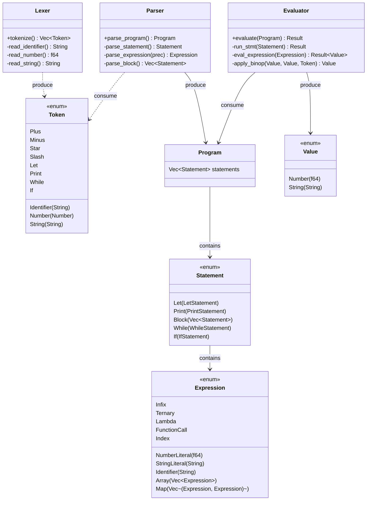

# HackLang

Lenguaje de programación interpretado, Turing completo, implementado en Rust.

## Arquitectura



### Componentes



## Sintaxis

```hacklang
let x = 42;
print x;

let y = x + 1;

while (i < 10) (
  print i;
  i = i + 1;
)

let result = (x > 10) ? ( x ) : ( 0 );

let add = |a, b| ( a + b );
print add(3, 4);
```

## Cómo usar

```bash
cd hacklangc
cargo run ../test.hl
```

## Metodología

### Pipeline de 3 fases

HackLang sigue el patrón clásico de **interprete sin IR** (Intermediate Representation). El código fuente pasa por exactamente 3 fases, una tras otra, sin transformaciones intermedias:

```
Source (.hl)  ──[Lexer]──▶  Tokens  ──[Parser]──▶  AST  ──[Evaluator]──▶  Output
```

Cada fase es un módulo independiente de Rust (`lexer.rs`, `parser.rs`, `evaluador.rs`) que se comunica con el siguiente solo a través de su tipo de salida (`Vec<Token>` → `Program` → `Result<(), String>`). No hay paso intermedio, ni optimizaciones, ni generación de código.

### Flujo de errores

Los errores se propagan con `Result<T, String>` en lugar de `panic!` o excepciones. Cada fase puede fallar y el error sube hasta `main()`:

```
Evaluator → Err(String) → main → eprintln!("Error en tiempo de ejecución: {e}")
```

Esto mantiene el programa principal limpio (línea 48 de `main.rs`) y toda la lógica de error dentro de cada fase.

## Arquitectura y Patrones de Diseño

### Interpreter Pattern (el patrón central)

HackLang implementa el **Interpreter pattern** del GoF, adaptado a Rust con enums y pattern matching:

```rust
// AST = expresión jerárquica
enum Expression {
    NumberLiteral(f64),
    Infix { left: Box<Expression>, operator: Token, right: Box<Expression> },
    Ternary { condition: Box<Expression>, true_branch: Box<Expression>, false_branch: Box<Expression> },
    // ...
}

// Evaluator = walker recursivo
fn eval_expression(&self, expr: &Expression) -> Result<Value, String> {
    match expr {
        Expression::NumberLiteral(n) => Ok(Value::Number(*n)),
        Expression::Infix { left, operator, right } => {
            let l = self.eval_expression(left)?;
            let r = self.eval_expression(right)?;
            self.apply_binop(l, r, operator)
        }
        // ...
    }
}
```

No se usan trait objects ni vtables. El AST es un enum con variantes planas y el evaluador es una función que recorre el árbol con `match`. Esto es deliberado: KISS sobre abstracción.

### Pratt Parser (expresiones)

El parser de expresiones usa **Pratt parsing** (también llamado _Top-Down Operator Precedence_), que asigna precedencia a cada token y resuelve la asociatividad de forma matemática sin necesidad de una gramática LR o un parser generator:

```rust
fn parse_expression(&mut self, precedence: Precedence) -> Result<Expression, String> {
    let mut left = self.parse_prefix()?;
    while precedence < self.get_precedence(self.current_token()) {
        let op = self.current_token().clone();
        self.advance();
        let right = self.parse_expression(self.get_precedence(&op))?;
        left = Expression::Infix { left: Box::new(left), operator: op, right: Box::new(right) };
    }
    // Post-procesamiento para ternario
    Ok(left)
}
```

Ventaja sobre alternatives como `nom` o `peg`:
- Control total sobre errores y recuperación (mensajes en español)
- Sin dependencias externas
- Código explícito y legible

### Recursive Descent (sentencias)

El parser de sentencias usa **Recursive Descent**: una función por cada construcción del lenguaje (`parse_let_statement`, `parse_while_statement`, `parse_if_statement`, etc.), cada una avanzando tokens y llamando a otras funciones de parsing según la gramática.

### Visitor sobre enums (evaluador)

El evaluador actúa como un **Visitor** pero sin el patrón clásico de doble dispatch — Rust lo resuelve con `match` sobre el enum del AST:

```rust
fn run_stmt(&mut self, stmt: &Statement) -> Result<(), String> {
    match stmt {
        Statement::Let(l)    => self.eval_let(l),
        Statement::Print(p)  => self.eval_print(p),
        Statement::Block(ss) => { for s in ss { self.run_stmt(s)?; } Ok(()) }
        Statement::While(w)  => { /* loop hasta que condition sea false */ }
        Statement::If(i)     => { /* eval condition → branch */ }
    }
}
```

### Environment como HashMap

El estado del programa (variables) se almacena en un `HashMap<String, Value>` dentro del `Evaluator`. No hay scoping anidado ni closures — es un único ámbito global.

## Principios Aplicados

### KISS (Keep It Simple, Stupid) — principio rector

Cada decisión de diseño se tomó preguntando "¿esto añade complejidad sin necesidad inmediata?":

- **Sin IR**: evaluamos directamente del AST, sin capa intermedia de optimización.
- **Sin trait objects**: el AST usa enums, no `Box<dyn Node>`. Pattern matching es más simple que vtables.
- **Sin genéricos ni macros complejas**: el evaluador es código plano con `match`.
- **Sin lifetimes complejas**: se clona lo necesario (`s.clone()`, `name.clone()`) en lugar de tejer referencias.

### YAGNI (You Aren't Gonna Need It) — stubs con error claro

Las features que no están implementadas devuelven un error explícito en lugar de valores basura o infraestructura completa:

```rust
Expression::Lambda { .. }       => Err("Lambda not implemented".to_string()),
Expression::FunctionCall { .. } => Err("FunctionCall not implemented".to_string()),
Expression::Array(_)            => Err("Array not implemented".to_string()),
```

Esto evita construir el sistema de closures, tipado, etc., hasta que sea realmente necesario.

### DRY — con límites

Donde tiene sentido, hay factorización clara (ej: `parse_block` y `parse_block_statement` comparten lógica). Pero no se fuerza la abstracción donde haría el código más opaco.

### Error Handling idiomático en Rust

Toda función que puede fallar devuelve `Result<T, String>`. El operador `?` propaga errores automáticamente:

```rust
fn evaluate(&mut self, program: &Program) -> Result<(), String> {
    for stmt in &program.statements {
        self.run_stmt(stmt)?;  // si falla, corta y sube el error
    }
    Ok(())
}
```

La única excepción son errores léxicos irrecuperables (`panic!` en el lexer), porque un token mal formado no permite continuar el análisis.

## Estado

| Componente | Estado |
|---|---|
| **Lexer** | ✅ Completo |
| **Parser** | ✅ Completo (infix, ternario, lambdas, arrays, mapas, indexación) |
| **Evaluador** | ⚠️ Parcial — lambdas, arrays, mapas, index y llamadas son stubs |
| **Tests** | ❌ Pendientes |
