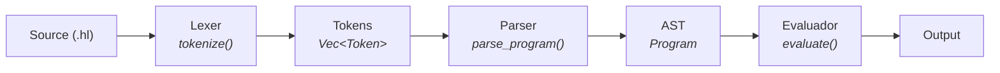
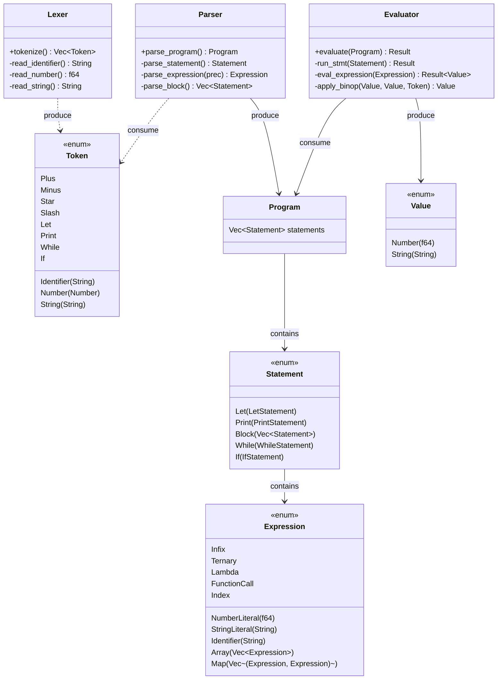

# HackLang

Lenguaje de programación interpretado, Turing completo, implementado en Rust.

## Arquitectura



### Componentes



## Sintaxis

```hacklang
let x = 42;
print x;

let y = x + 1;

while (i < 10) {
  print i;
  i = i + 1;
}

let result = (x > 10) ? { x } : { 0 };

let add = |a, b| { a + b };
print add(3, 4);
```

## Cómo usar

```bash
cd hacklangc
cargo run ../test.hl
```

## Estado

| Componente | Estado |
|---|---|
| **Lexer** | ✅ Completo |
| **Parser** | ✅ Completo (infix, ternario, lambdas, arrays, mapas, indexación) |
| **Evaluador** | ⚠️ Parcial — lambdas, arrays, mapas, index y llamadas son stubs |
| **Tests** | ❌ Pendientes |
