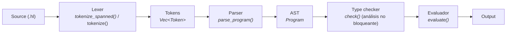

# HackLang

Lenguaje de programación implementado en Rust. Actualmente dispone de un intérprete; la compilación de ejecutables nativos es el objetivo de desarrollo prioritario y todavía no está implementada.

## Arquitectura



### Componentes

```mermaid
classDiagram
    class Lexer {
        +tokenize() Vec~Token~
        -read_identifier() String
        -read_number() f64
        -read_string() String
    }
    class Token {
        <<enum>>
        Plus
        Minus
        Star
        Slash
        Let
        Print
        While
        If
        Identifier(String)
        Number(Number)
        String(String)
    }
    class Parser {
        +parse_program() Program
        -parse_statement() Statement
        -parse_expression(prec) Expression
        -parse_block() Vec~Statement~
    }
    class Program {
        Vec~Statement~ statements
    }
    class Statement {
        <<enum>>
        Let(LetStatement)
        Assign(AssignStatement)
        IndexAssign(IndexAssignStatement)
        Print(PrintStatement)
        Return(Expression)
        Break
        Continue
        Block(Vec~Statement~)
        While(WhileStatement)
        If(IfStatement)
    }
    class Expression {
        <<enum>>
        NumberLiteral(f64)
        BoolLiteral(bool)
        StringLiteral(String)
        Identifier(String)
        Infix
        Ternary
        Lambda
        Block(Vec~Statement~)
        FunctionCall
        Array(Vec~Expression~)
        Map(Vec~(Expression, Expression)~)
        Index
    }
    class Evaluator {
        +evaluate(Program) Result
        -run_stmt(Statement) Result
        -eval_expression(Expression) Result~Value~
        -apply_binop(Value, Value, Token) Value
    }
    class Value {
        <<enum>>
        Number(f64)
        Bool(bool)
        String(String)
        Array(Vec<Value>)
        Map(Vec<(Value, Value)>)
        Function
    }

    Lexer ..> Token : produce
    Parser ..> Token : consume
    Parser --> Program : produce
    Program --> Statement : contains
    Statement --> Expression : contains
    Evaluator --> Program : consume
    Evaluator --> Value : produce
```



## Sintaxis

```hacklang
let x = 42;
print x;

let y = x + 1;

while (i < 10) (
  print i;
  i = i + 1;
)

let result = (x > 10) ? ( x ) : ( 0 );

let add = |a, b| ( a + b );
print add(3, 4);

let datos = @( "host": "127.0.0.1", "port": 80 );
print datos["host"];
```

Los ejemplos ejecutables de la versión actual están en `examples/`. Los bocetos que dependen de funciones todavía inexistentes (`read_file`, `write_file`, `exec`) se conservan en `prototypes/unsupported/` y no son programas ejecutables.

## Cómo usar

Desde la raíz del repositorio:

```bash
cargo run -- examples/test.hl
cargo run -- --compact programa-compacto.hl
cargo run -- --format programa.hl
cargo run -- --diagnostics-json programa.hl
```

Para generar el ejecutable optimizado `hl`:

```bash
cargo build --release
./target/release/hl examples/test.hl
```

En Windows, el ejecutable se genera como `target/release/hl.exe`. Cargo gestiona los artefactos de compilación dentro de `target/`, que no se versiona.

### Sintaxis compacta experimental

La sintaxis compacta se activa explícitamente con `--compact`; el modo legacy sigue siendo el predeterminado y conserva su gramática.

```hacklang
n:=10
sum:=0
while n>0{
  sum=sum+n
  n=n-1
}
print sum

fact:=|n|{
  if n<2{return 1}else{return n*fact(n-1)}
}
print fact(5)
```

Ejecutar un archivo compacto:

```bash
cargo run -- --compact compact.hl
```

Convertir un programa legacy a la forma canónica compacta (sin ejecutarlo):

```bash
cargo run -- --format programa.hl
```

Para formatear un archivo que ya usa el modo compacto:

```bash
cargo run -- --compact --format compact.hl

# Static diagnostics as JSON (analysis only; does not execute the program)
cargo run -- --diagnostics-json programa.hl
```

En esta primera versión se compactan las declaraciones (`:=`), los bloques (`{}`), las condiciones de `if/while`, los cuerpos de lambdas y los mapas (`@{}`). En modo legacy, las declaraciones usan `let`, los bloques usan `(...)` y los mapas usan `@(...)`. Se mantienen `print`, `return`, `break` y `continue` como palabras clave para evitar colisiones con operadores existentes. No se exige punto y coma entre sentencias cuando el siguiente token permite determinar el final de la expresión.

## Objetivo de desarrollo: ejecutables nativos

El siguiente objetivo es que un mismo programa pueda ejecutarse con el intérprete Rust o compilarse a un ejecutable nativo del sistema. La interfaz prevista es `hl run`, `hl build` y `hl check`, manteniendo `hl programa.hl` como alias de ejecución. Estos subcomandos todavía no están implementados.

La estrategia es reutilizar el front-end existente (lexer, parser, AST y checker) y el evaluador Rust como referencia semántica. El backend nativo inicial generará C y enlazará un runtime propio con GCC o Clang. No se duplicará el parser ni se hará obligatorio el checker estático. La especificación y el inventario de componentes reutilizables están en [docs/NATIVE_COMPILER_DESIGN.md](docs/NATIVE_COMPILER_DESIGN.md).

## Metodología

### Pipeline de ejecución

HackLang sigue el patrón clásico de **intérprete sin IR** (Intermediate Representation). El flujo principal pasa por tres fases: lexer, parser y evaluador. No hay generación de código ni una representación intermedia adicional:

```
Source (.hl)  ──[Lexer]──▶  Tokens  ──[Parser]──▶  AST  ──[Evaluator]──▶  Output
```

Cada fase es un módulo independiente de Rust (`lexer.rs`, `parser.rs`, `evaluador.rs`) que se comunica con el siguiente solo a través de su tipo de salida (`Vec<Token>` → `Program` → `Result<(), String>`). El análisis estático es una pasada independiente y no bloqueante entre el parser y el evaluador. No hay IR, optimizaciones ni generación de código.

### Flujo de errores

Los errores se propagan con `Result<T, String>` en lugar de `panic!` o excepciones. Cada fase puede fallar y el error sube hasta `main()`:

```
Evaluator → Err(String) → main → eprintln!("Error en tiempo de ejecución: {e}")
```

Esto mantiene el programa principal limpio (línea 48 de `main.rs`) y toda la lógica de error dentro de cada fase.

## Arquitectura y Patrones de Diseño

### Interpreter Pattern (el patrón central)

HackLang implementa el **Interpreter pattern** del GoF, adaptado a Rust con enums y pattern matching:

```rust
// AST = expresión jerárquica
enum Expression {
    NumberLiteral(f64),
    Infix { left: Box<Expression>, operator: Token, right: Box<Expression> },
    Ternary { condition: Box<Expression>, true_branch: Box<Expression>, false_branch: Box<Expression> },
    // ...
}

// Evaluator = walker recursivo
fn eval_expression(&self, expr: &Expression) -> Result<Value, String> {
    match expr {
        Expression::NumberLiteral(n) => Ok(Value::Number(*n)),
        Expression::Infix { left, operator, right } => {
            let l = self.eval_expression(left)?;
            let r = self.eval_expression(right)?;
            self.apply_binop(l, r, operator)
        }
        // ...
    }
}
```

No se usan trait objects ni vtables. El AST es un enum con variantes planas y el evaluador es una función que recorre el árbol con `match`. Esto es deliberado: KISS sobre abstracción.

### Pratt Parser (expresiones)

El parser de expresiones usa **Pratt parsing** (también llamado _Top-Down Operator Precedence_), que asigna precedencia a cada token y resuelve la asociatividad de forma matemática sin necesidad de una gramática LR o un parser generator:

```rust
fn parse_expression(&mut self, precedence: Precedence) -> Result<Expression, String> {
    let mut left = self.parse_prefix()?;
    while precedence < self.get_precedence(self.current_token()) {
        let op = self.current_token().clone();
        self.advance();
        let right = self.parse_expression(self.get_precedence(&op))?;
        left = Expression::Infix { left: Box::new(left), operator: op, right: Box::new(right) };
    }
    // Post-procesamiento para ternario
    Ok(left)
}
```

Ventaja sobre alternatives como `nom` o `peg`:
- Control total sobre errores y recuperación (mensajes en español)
- Sin dependencias externas
- Código explícito y legible

### Recursive Descent (sentencias)

El parser de sentencias usa **Recursive Descent**: una función por cada construcción del lenguaje (`parse_let_statement`, `parse_while_statement`, `parse_if_statement`, etc.), cada una avanzando tokens y llamando a otras funciones de parsing según la gramática.

### Visitor sobre enums (evaluador)

El evaluador actúa como un **Visitor** pero sin el patrón clásico de doble dispatch — Rust lo resuelve con `match` sobre el enum del AST:

```rust
fn run_stmt(&mut self, stmt: &Statement) -> Result<Flow, String> {
    match stmt {
        Statement::Let(l)       => self.eval_let(l).map(|_| Flow::Continue),
        Statement::Return(expr) => self.eval_expression(expr).map(Flow::Return),
        Statement::Break         => Ok(Flow::Break),
        Statement::Continue      => Ok(Flow::LoopContinue),
        Statement::Block(ss)     => { /* propaga Return, Break y Continue */ }
        Statement::While(w)      => { /* consume Break/Continue y propaga Return */ }
        Statement::If(i)         => { /* evalúa condición y propaga el flujo */ }
        // Assign, IndexAssign y Print también producen Flow::Continue.
    }
}
```

### Entornos léxicos y closures

El runtime mantiene un arena de entornos (`Vec<Environment>`). Cada entorno contiene un `HashMap<String, Value>` y un enlace opcional a su entorno padre. Las variables se resuelven recorriendo esa cadena, desde el ámbito actual hacia los padres.

- `let` crea o reemplaza una vinculación en el ámbito actual.
- La asignación `x = ...` actualiza la vinculación existente más cercana.
- Los bloques, ramas, bucles y llamadas crean nuevos entornos.
- Una lambda captura el identificador estable del entorno donde se define. No clona todas las variables: ve también las modificaciones posteriores y puede ser recursiva.
- Los bloques, ramas, bucles y llamadas crean entornos con padre léxico.
- El recolector mark-and-sweep recupera frames no alcanzables y reutiliza sus IDs. Los valores contenidos siguen bajo gestión de memoria de Rust.

## Principios Aplicados

### KISS (Keep It Simple, Stupid) — principio rector

Cada decisión de diseño se tomó preguntando "¿esto añade complejidad sin necesidad inmediata?":

- **Sin IR**: evaluamos directamente del AST, sin capa intermedia de optimización.
- **Sin trait objects**: el AST usa enums, no `Box<dyn Node>`. Pattern matching es más simple que vtables.
- **Sin genéricos ni macros complejas**: el evaluador es código plano con `match`.
- **Sin lifetimes complejas**: se clona lo necesario (`s.clone()`, `name.clone()`) en lugar de tejer referencias.

### YAGNI (You Aren't Gonna Need It)

El runtime implementa primero las construcciones necesarias para ejecutar programas pequeños: funciones, closures léxicas, arrays, mapas e indexación. Las características que aún no existen deben fallar explícitamente; no deben simularse con valores por defecto ni con resultados silenciosos.

### DRY — con límites

Donde tiene sentido, hay factorización clara (ej: `parse_block` y `parse_block_statement` comparten lógica). Pero no se fuerza la abstracción donde haría el código más opaco.

### Error Handling idiomático en Rust

Toda función que puede fallar devuelve `Result<T, String>`. El operador `?` propaga errores automáticamente:

```rust
fn evaluate(&mut self, program: &Program) -> Result<(), String> {
    for stmt in &program.statements {
        self.run_stmt(stmt)?;  // si falla, corta y sube el error
    }
    Ok(())
}
```

El lexer y el parser devuelven `Result`: los caracteres desconocidos, las cadenas sin cerrar y los errores sintácticos llegan al CLI como mensajes controlados, sin provocar un `panic!`.

## Estado

El CLI se construye como el ejecutable `hl`. En desarrollo se invoca con `cargo run -- ...`; en release, Cargo genera `target/release/hl` (o `hl.exe` en Windows). No existe actualmente un comando `compile` ni generación de binarios nativos a partir de `.hl`.

| Componente | Estado |
|---|---|
| **Lexer** | ✅ Tokenización, palabras clave, operadores, cadenas y errores recuperables |
| **Parser** | ✅ Expresiones, ternario, lambdas, llamadas postfix, bloques, arrays, mapas e indexación |
| **Evaluador** | ✅ Evaluación de expresiones, booleanos, sentencias, ámbitos léxicos y colecciones |
| **Funciones** | ✅ Lambdas, closures léxicas, recursividad, llamadas de primera clase y aridad |
| **Control de flujo** | ✅ `return`, `break` y `continue` |
| **Memoria** | ✅ Mark-and-sweep de frames de entorno; los demás valores los gestiona Rust |
| **Análisis de tipos** | ✅ Primera pasada no bloqueante: tipos primitivos, retornos explícitos, arrays/mapas con tipos de elemento/clave/valor, indexación, asignaciones, operadores y aridad de llamadas |
| **Tests** | Tests Rust y ejecución de todos los `examples/*.hl` en GitHub Actions |


## Funcionalidad del runtime

- Las lambdas se evalúan como funciones y capturan el ID estable del entorno léxico donde se definen.
- Las llamadas comprueban el número de argumentos y ejecutan el cuerpo en un entorno local cuyo padre es el entorno capturado.
- Los cuerpos de función admiten varias sentencias y `return` explícito.
- `return` se propaga a través de bloques, ramas y bucles; `break` y `continue` controlan el bucle más cercano.
- Los arrays admiten literales, lectura por índice y actualización de posiciones existentes.
- Los mapas admiten claves y valores evaluados, lectura por clave y alta o actualización de entradas.
- La indexación de cadenas devuelve el carácter solicitado.
- Los errores al evaluar condiciones de `while` se propagan; ya no se convierten silenciosamente en una condición falsa.

Limitaciones actuales: la asignación por índice solo admite como destino una variable identificada directamente (no indexación anidada); los mapas se representan como pares ordenados. El comprobador estático inicial es deliberadamente no bloqueante: informa de incompatibilidades demostrables y deja como `unknown` los casos que aún no puede inferir. El runtime mantiene la conversión dinámica de números, cadenas y colecciones en condiciones por compatibilidad. Las comparaciones numéricas producen `true` o `false`, no `1` o `0`.


## Modelo de memoria y ejecución

- **Stack (pila):** la evaluación de expresiones y las llamadas a funciones usan recursión de Rust; por tanto, la pila de llamadas real es la pila nativa del proceso. El evaluador limita la profundidad a 256 niveles y devuelve un error controlado al superar el límite. Los bucles del lenguaje se ejecutan iterativamente. HackLang todavía no tiene una VM ni una pila de operandos propia. El parser también aplica límites de 256 niveles a expresiones y sentencias anidadas.
- **Heap (montículo):** el AST usa `Box` para nodos recursivos y `Vec` para listas; cadenas, mapas y tablas de variables usan estructuras propiedad de Rust. El arena de entornos también vive en el heap. Un recolector mark-and-sweep recupera frames no alcanzables y reutiliza sus posiciones; no es un GC general de objetos, porque los valores los gestiona Rust.
- **Closures:** guardan un ID de entorno, no una copia completa del `HashMap`. La cadena de entornos proporciona el alcance léxico y permite recursividad.
- **Liberación:** Rust libera automáticamente los valores cuando se destruye el evaluador. El arena recolecta frames inalcanzables después de cada sentencia, incluyendo el seguimiento de closures contenidas en valores y de closures devueltas temporalmente. No hay un garbage collector general para todos los objetos: Rust gestiona la vida de cadenas, arrays, mapas y AST.


### Errores léxicos y sintácticos

El lexer expone `tokenize() -> Result<Vec<Token>, String>` y el parser `parse_program() -> Result<Program, String>`. Un carácter desconocido, una cadena sin cerrar o una sentencia mal formada produce un error recuperable que el ejecutable muestra al usuario. Las pruebas cubren también cadenas Unicode para evitar errores al confundir índices de caracteres con índices de bytes.


## Biblioteca estándar inicial

- `len(x)`: número de caracteres Unicode en strings o cantidad de elementos en arrays y mapas. Acepta un argumento y valida tipos en análisis estático.
